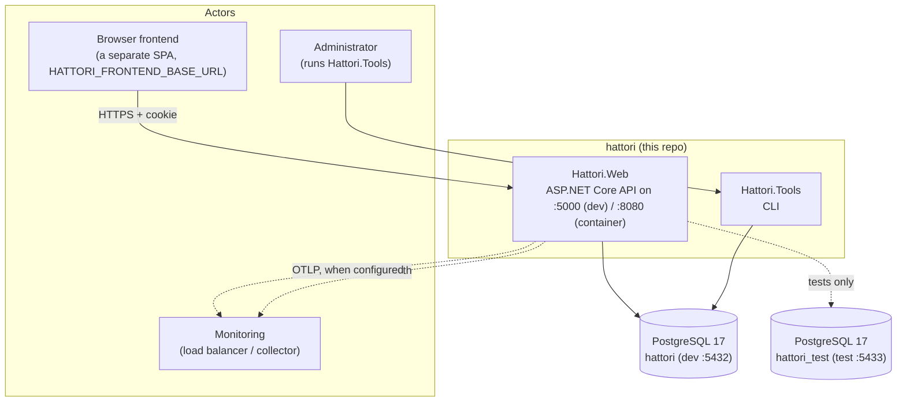

# 01 · System overview

hattori is a REST API that stores todo lists and todo items for signed-in users. It is a backend for a separate frontend (no UI of its own), plus a CLI for administration.

Solid arrows are runtime dependencies; dotted ones are optional or test-only.

## The stack, and why each piece

| Piece | Choice | Why this and not the other |
| --- | --- | --- |
| API style | Controllers deriving `ControllerBase` | Scales better in a large project than minimal APIs; one class per resource with shared filters/policies. |
| Data access | EF Core 10 + Npgsql, through repositories | LINQ projection straight into DTOs; provider change means changing `.Persistence` only. |
| Database | PostgreSQL 17 | Native `uuid`, `timestamp with time zone`, `date`, `jsonb` types; partial unique indexes for soft-delete-aware uniqueness. |
| Identity | ASP.NET Core Identity (`AddIdentityApiEndpoints`) | Login/refresh/logout endpoints for free; permission claims model on top (see [05](05-security.md)). |
| Logging | Serilog behind `ILogger<T>` | Rolling files + labelled UTC timestamps; provider can change later because web code only sees `ILogger<T>`. |
| Telemetry | OpenTelemetry, only when `OTEL_EXPORTER_OTLP_ENDPOINT` is set | Traces and metrics reach the same collector as logs when one exists; zero cost when it doesn't. |
| Tests | NUnit against real PostgreSQL | The EF in-memory provider doesn't enforce constraints and behaves differently from Postgres. |
| API docs | Microsoft.AspNetCore.OpenApi + Scalar, development only | `[EndpointDescription]` on every action becomes the description the frontend reads; no docs surface in production. |
| CLI tools | System.CommandLine (`Hattori.Tools`) | Admin jobs (seed, create-admin) are not web endpoints; the CLI reads the same environment variables as the API. |

## What the system does

- **Accounts:** register (public, rate-limited), login/logout/refresh via the identity API under `/account`, read one's own profile.
- **Todo lists:** create, rename, recolor, soft-delete; names unique per user among live lists.
- **Todo items:** create in a list, list (optionally filtered), full replace, complete (stamping the completion moment), soft-delete.
- **Operations:** `/health` endpoint, startup-fail-fast on missing settings, structured logs with a startup header.

Boundaries: everything an outsider can do enters as HTTP at `Hattori.Web` (or as a CLI command at `Hattori.Tools`); nothing else touches the database.

Next: [02 · Containers](02-containers.md).
