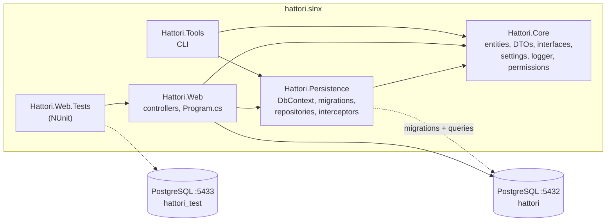

# 02 · Containers

Five projects and two databases. The rule that shapes everything: **references point one way**, so dependencies never cycle and the core stays reusable.

## The projects

| Project | Kind | Owns | Must never contain |
| --- | --- | --- | --- |
| `Hattori.Core` | classlib | Entities, DTOs, repository/service interfaces, `Authorization/` permission constants, `Configurations/` settings, `Logger/` Serilog setup, `Development/DebugUtils` | Any EF Core package (`Microsoft.Extensions.Identity.Stores` is the identity dependency it is allowed) |
| `Hattori.Persistence` | classlib | `HattoriDbContext`, `Migrations/`, `Repositories/`, `Interceptors/AuditInterceptor`, `HattoriUserClaimsPrincipalFactory`, `HattoriDatabaseRegistration` | Controllers, HTTP concerns (except `IHttpContextAccessor` for the interceptor) |
| `Hattori.Web` | web app | `Program.cs`, `Controllers/`, `Authorization/PermissionAuthorizationHandler`, `launchSettings.json`, Dockerfile, `.http` file | A `DbContext` injection, EF packages (they all live in `.Persistence` and flow transitively) |
| `Hattori.Web.Tests` | NUnit | Repository tests, one whole-pipeline `WebApplicationFactory` test, `TestEnvironment` fixture | The EF in-memory provider |
| `Hattori.Tools` | console | Command tree (`users`, `roles`, `db`), `AdministrationCommands`, interactive menu | Web hosting; it builds its own DI container |

Consequences of the direction: to change database provider, only `.Persistence` changes; to reuse domain types, reference `.Core` alone; `Program.cs` wires implementations to `.Core` interfaces so the web layer is testable through fakes.

## Databases and topologies

| Environment | Database | Who connects |
| --- | --- | --- |
| Development | `hattori` on `localhost:5432` (container `hattori-postgres`) | `dotnet watch` in `Hattori.Web`; `Hattori.Tools` |
| Test | `hattori_test` on `localhost:5433` (container `hattori-postgres-test`) | `Hattori.Web.Tests`, both repository fixtures and the pipeline test |
| Production | Any PostgreSQL, from `HATTORI_DATABASE_CONNECTION_STRING` | The published container |

Both containers are `postgres:17-alpine` (`docker run` commands in the [README](../../README.md)). Connections come from `DatabaseSettings`, never from a string in code that uses them.

## Deployment shape

- `Hattori.Web/Dockerfile`, built from the solution root: `aspnet:10.0` base, runs as non-root `$APP_UID`, exposes 8080. It copies `Directory.Build.props` and every project file before `dotnet restore`, so the restore layer is cached.
- Every setting arrives as an environment variable; a Release build refuses to start when a required one is missing (see [07](07-cross-cutting.md)).
- Migrations are a deploy step (`dotnet ef database update` or a migration bundle), not startup magic.
- `/health` is anonymous and answers 200 only when the database check passes, for the load balancer.

Next: [03 · Components](03-components.md).
