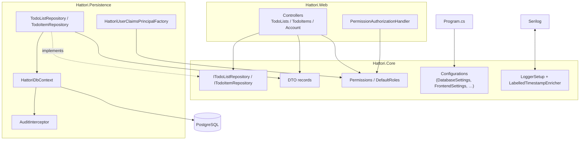

# 03 · Components

Type-by-type tour of what is inside each project. Full request dynamics are in [06](06-request-lifecycle.md); this page is the static map.

## Hattori.Core

| Type | Job |
| --- | --- |
| `Entities/TodoList`, `Entities/TodoItem` | The domain rows. Both implement `ISoftDeletable` and `IAuditable`; every property sets what it is for. |
| `Entities/HattoriUser : IdentityUser<Guid>` | The account. Lives in Core via `Microsoft.Extensions.Identity.Stores`, which carries no EF dependency. |
| `Entities/ISoftDeletable`, `Entities/IAuditable` | Marker contracts driving query filters and the audit interceptor. |
| `DTOs/*` | Records for requests and responses, with data annotations for validation. Entities never cross the API boundary. |
| `Interfaces/ITodoListRepository`, `ITodoItemRepository` | The persistence contract the controllers see — DTOs in, DTOs out, every method scoped to an owner. |
| `Authorization/Permissions` | Every permission constant (`TodoList.READ`, …), the `permission` claim type, and `ALL` used to register one policy per permission. |
| `Authorization/DefaultRoles` | The `User` / `Administrator` role names and `PermissionsFor(role)`, the single source of which role grants what. |
| `Authorization/PermissionRequirement` | The `IAuthorizationRequirement` carrying one permission name through authorization. |
| `Configurations/EnvironmentVariables` | The only code allowed to call `Environment.GetEnvironmentVariable`. `Required(name, debugDefault)` warns-and-falls-back in Debug, throws in Release. |
| `Configurations/DatabaseSettings` | Both connection strings, each read once via `Lazy` (`HATTORI_DATABASE_CONNECTION_STRING`, `HATTORI_TEST_DATABASE_CONNECTION_STRING`). |
| `Configurations/FrontendSettings` | CORS origins, comma-separated `HATTORI_FRONTEND_BASE_URL`. |
| `Configurations/LogSettings` | `HATTORI_LOG_TIMEZONE` as a validated `TimeZoneInfo`, defaulting to UTC. |
| `Configurations/TelemetrySettings` | Whether `OTEL_EXPORTER_OTLP_ENDPOINT` is set. |
| `Logger/LoggerSetup` | One-time Serilog configuration: console + rolling file, level policy, startup header, Fatal-on-unhandled, OTLP-conditional. |
| `Logger/LabelledTimestampEnricher` | Adds the `LogTimestamp` property ("2026-11-05 12:00:00 GMT") so every line names its zone. |
| `Development/DebugUtils` | `IsDebugBuild`, the one place the `#if DEBUG` switch lives. |

## Hattori.Persistence

| Type | Job |
| --- | --- |
| `HattoriDbContext` | `IdentityDbContext<HattoriUser, IdentityRole<Guid>, Guid>` plus the todo model: PostgreSQL-native column types, indexes, the partial unique index on live list names, cascade delete list→items, and query filters hiding soft-deleted rows. |
| `Repositories/TodoListRepository`, `Repositories/TodoItemRepository` | The EF implementations of the Core interfaces. Reads are `AsNoTracking` projections into DTOs; writes save their own change; every query is scoped by owner; delete = set `IsDeleted`/`DeletedAt`. |
| `Interceptors/AuditInterceptor` | `SaveChangesInterceptor` stamping `IAuditable` fields (`CreatedById`, `UpdatedById`, `UpdatedAt`) from the current user on every save — the only writer of those fields. |
| `HattoriUserClaimsPrincipalFactory` | Copies the permission claims of the user's roles into the principal whenever a cookie is issued. |
| `HattoriDatabaseRegistration` | `AddHattoriPersistence(target)` — one call wiring DbContext + interceptor + repositories + the database health check; `BuildOptions(target)` for tests and tools. |
| `Migrations/` | EF migrations, applied by `dotnet-ef` (pinned as a local tool). |

## Hattori.Web

| Type | Job |
| --- | --- |
| `Program.cs` | The composition root: logger, fail-fast settings read, persistence, identity, permission policies, cookie/CORS/rate limiting, OpenAPI (dev), OTLP (conditional), the exact middleware order, endpoint maps. |
| `Controllers/TodoListsController` | `api/todo-lists` CRUD. Normalizes names (trim + lowercase), returns 409 on duplicates, 404 on missing, owns nothing but the interface. |
| `Controllers/TodoItemsController` | `api/todo-items` CRUD + list filtering. Verifies the parent list exists and is owned before creating; completion semantics live in the repository. |
| `Controllers/AccountController` | Public `api/account/register` (creates account + default role + signs in) and `api/account/me`. |
| `Authorization/PermissionAuthorizationHandler` | Succeeds a `PermissionRequirement` when the principal carries that permission claim. |

## Hattori.Web.Tests

| Piece | Job |
| --- | --- |
| `TestEnvironment` | `SetUpFixture` pointing both database settings at the 5433 test database before anything reads them. |
| `TodoListRepositoryTests`, `TodoItemRepositoryTests` | Repository behavior against real Postgres: visibility, ownership, uniqueness, update semantics, soft delete. Migrate once per fixture; clean tables per test. |
| `WebPipelineTests` | Boots the whole app with `WebApplicationFactory<Program>`: register → create list → create item → complete → soft-delete, plus anonymous 401 and `/health`. |

## Hattori.Tools

| Piece | Job |
| --- | --- |
| `Program.cs` | Builds the same services as the web host minus HTTP (its own DbContext, identity, DataProtection), defines the command tree and the no-argument interactive menu. |
| `AdministrationCommands` | `CreateAdministratorAsync`, `SeedRolesAsync`, `CheckDatabaseAsync`, `SeedDemoDataAsync` (idempotent per account). |

Next: [04 · Data model](04-data-model.md).
