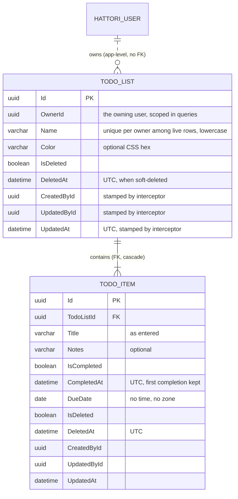

# 04 · Data model

Two todo tables on top of the standard Identity tables. PostgreSQL-native types throughout: `uuid`, `character varying(n)`, `timestamp with time zone`, `date`, `boolean`.



(The `HATTORI_USER → TODO_LIST` edge is dotted because there is deliberately no foreign key — [ADR 0002](decisions/0002-owner-id-without-foreign-key.md).)

## Integrity rules and where they live

| Rule | Enforced by |
| --- | --- |
| List name unique per owner among **live** lists | `IX_TodoList_OwnerId_Name` unique with filter `"IsDeleted" = false`, **and** `ExistsAsync` checked by the controller (409) |
| Item belongs to an existing list | Foreign key `FK_TodoItem_TodoList_TodoListId`, `ON DELETE CASCADE` |
| Ownership isolation | Every repository query filters by `OwnerId` (lists) or `TodoList.OwnerId` (items) |
| Deleted rows invisible | EF global query filters `HasQueryFilter(e => !e.IsDeleted)` on both entities |

A soft-deleted list therefore *frees its name* — the uniqueness filter excludes it — and its items vanish from every read without being touched, because item queries join through the filtered list.

## Soft delete

Nobody calls `Remove()` on these entities. Deleting writes:

- `IsDeleted = true`
- `DeletedAt = DateTime.UtcNow`

Reads see nothing afterwards (query filter). The rows stay for audit and can be reached deliberately with `IgnoreQueryFilters()` — the tests use exactly that to clean up.

## Audit fields

`CreatedById`, `UpdatedById`, `UpdatedAt` are written by `AuditInterceptor` alone, on every `Added`/`Modified` save, from the current user's `nameid` claim:

- On the request path: the signed-in user's ID.
- In `Hattori.Tools` or tests (no HTTP context): user columns stay `null`, `UpdatedAt` still stamps.

Never set these fields by hand — hand-set values are overwritten on the next save.

## Time semantics

| Column | Kind | Written as |
| --- | --- | --- |
| `UpdatedAt`, `DeletedAt`, `CompletedAt` | UTC moments (`timestamp with time zone`) | `DateTime.UtcNow` |
| `DueDate` | A date with no time (`date`) | User input, never converted |

Completing an item stamps `CompletedAt` **once** (`item.CompletedAt ?? DateTime.UtcNow`); reopening clears it; completing again stamps fresh. Rationale in [ADR 0005](decisions/0005-dateonly-due-dates.md).

## Migrations

`dotnet-ef` is pinned as a local tool (`.config/dotnet-tools.json`, currently 10.0.14) — `dotnet tool restore` after cloning.

```shell
cd Hattori.Web
dotnet ef migrations add <Name> --project ../Hattori.Persistence
dotnet ef database update --project ../Hattori.Persistence
```

Workflow rules:

- Read every generated migration before committing it; both `Up()` and `Down()` must make sense.
- Migrations are generated from `Hattori.Web` (the startup project) into `Hattori.Persistence`.
- Apply migrations as a deploy step — never automatically at app startup.

Next: [05 · Security](05-security.md).
