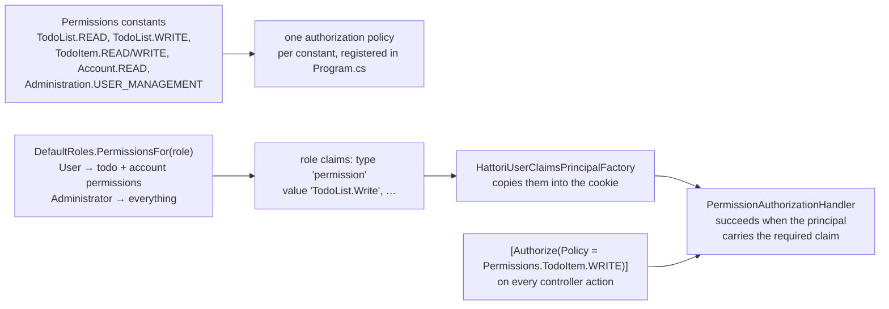
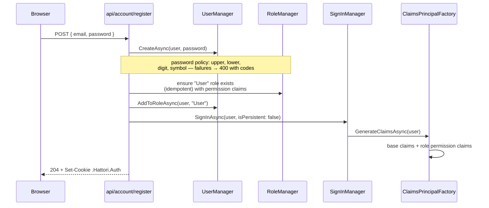

# 05 · Security

One idea carries the design: **roles hold permissions as claims, the cookie bakes them in at sign-in, and every endpoint checks a named policy.** Nothing at request time reads the database to decide authorization.

## The permission model

- `Permissions` (Core) is the single list; `Permissions.ALL` drives policy registration, so an endpoint can never ask for a policy that does not exist.
- `DefaultRoles.PermissionsFor` is the single map of role → permissions, used by the register endpoint and the tools when seeding.
- The tradeoff — permission changes apply at next sign-in, not instantly — is accepted in [ADR 0006](decisions/0006-permissions-in-cookie.md).

## Registration and sign-in

Why a custom register endpoint instead of Identity's: registration must also assign the default role. Identity's own `POST /account/register` is answered with **404** by a middleware after `UseCors` — [ADR 0004](decisions/0004-own-register-endpoint.md). Login, refresh, logout and profile management stay on the identity API endpoints under `/account`.

## The cookie

`ConfigureApplicationCookie` sets:

| Setting | Development | Production |
| --- | --- | --- |
| `SameSite` | `Lax` | `None` |
| `SecurePolicy` | `SameAsRequest` | `Always` |
| `HttpOnly` | always | always |
| Name | `.Hattori.Auth` | `.Hattori.Auth` |

`OnRedirectToLogin` / `OnRedirectToAccessDenied` write **401 / 403** instead of redirecting — an API never sends a login page. `AddCookiePolicy(MinimumSameSitePolicy = None)` stops the cookie middleware from downgrading `SameSite=None` on plain HTTP.

## Perimeter rules

| Concern | Mechanism |
| --- | --- |
| Brute force | Rate limiter policy `login`: 10 requests / minute / client IP, 429 on the `/account` identity group and `api/account/register`. Behind a proxy, configure forwarded headers or every client shares one limit. |
| Cross-origin | CORS `WithOrigins(HATTORI_FRONTEND_BASE_URL …)` — a comma-separated setting, never a hard-coded origin — with credentials allowed. |
| Input validation | Data annotations on the DTO records; `[ApiController]` answers 400 before the action runs. Passwords also pass the Identity policy. |
| Information leak | `AddProblemDetails` + `UseExceptionHandler`: unhandled exceptions become a clean 500, no stack trace to the client. |
| Deliberately public | `POST /api/account/register` and `GET /health` only. Everything else is `[Authorize]` + a policy. |

## Data-level isolation

Authorization decides *who may call what*; isolation decides *whose rows they see*. Every repository method takes the owner ID from the controller (`User`'s `nameid` claim) and scopes every query by it, so one user can never read or write another's lists or items — enforced in the repositories, tested in `AnotherUsersListIsInvisible` / `ItemInAnotherUsersListIsInvisible`.

Next: [06 · Request lifecycle](06-request-lifecycle.md).
