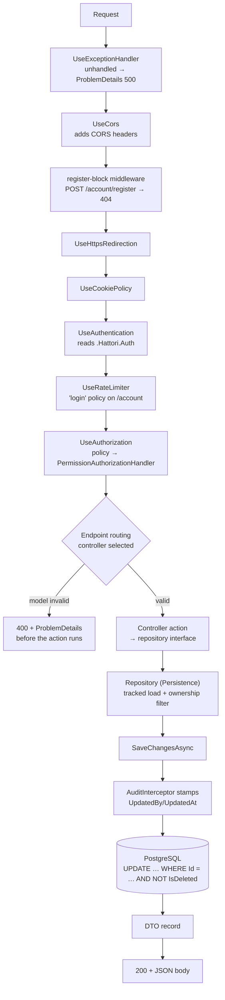

# 06 · Request lifecycle

The middleware pipeline in exact order — the skill's order, with the one insertion this app makes — followed by one request traced to the database row and back.

## The pipeline, hop by hop

| # | Middleware | What it does here |
| --- | --- | --- |
| 1 | `UseExceptionHandler` | Last-chance handler → logged error + `ProblemDetails` 500. Expected failures never reach it; they return status helpers. |
| 2 | `UseCors` | Applies the `Frontend` policy (origins from `HATTORI_FRONTEND_BASE_URL`, credentials allowed). Placed before the register block so even the 404 carries CORS headers. |
| 3 | register block (`app.Use`) | Answers `POST /account/register` with 404 — self-registration is `api/account/register` only. |
| 4 | `UseHttpsRedirection` | Redirects plain HTTP in production. |
| 5 | `UseCookiePolicy` | Keeps `SameSite=None` intact. |
| 6 | `UseAuthentication` | Validates the `.Hattori.Auth` cookie into a `ClaimsPrincipal` (scheme `Identity.BearerAndApplication`: cookie or bearer). |
| 7 | `UseRateLimiter` | Rejects over-limit sign-in attempts with 429. |
| 8 | `UseAuthorization` | Runs the endpoint's policy; `PermissionAuthorizationHandler` checks the `permission` claim. |
| 9 | endpoint routing (`MapControllers`, `/account` identity group, `/health`) | Model binding + annotation validation run before the action (`[ApiController]`). |

## One request, end to end: `PUT /api/todo-items/{id}`

Body: `{ "title": "Take out the trash", "notes": null, "isCompleted": true, "dueDate": "2026-11-06" }`

1. **AuthN:** the cookie decrypts into claims — `nameid` (the user's ID), role, and the role's `permission` claims baked at sign-in.
2. **AuthZ:** `[Authorize(Policy = Permissions.TodoItem.WRITE)]` → the handler looks for a `permission` claim equal to `TodoItem.Write`. Present → 200 continues; absent-but-authenticated → **403**; no cookie → **401** (never a redirect).
3. **Binding/validation:** `UpdateTodoItemDto` binds; `[Required]`/`[StringLength]` pass (a 500-char title would have been a 400 here).
4. **Controller** (`TodoItemsController.UpdateItem`): reads the owner ID from the `nameid` claim via its private `getUserId()`, trims the title and notes, and calls `ITodoItemRepository.UpdateAsync(ownerId, id, …)` with the `CancellationToken` from the request — a client hang-up cancels the query.
5. **Repository** (`TodoItemRepository.UpdateAsync`): loads the tracked item with `FirstOrDefaultAsync(i => i.Id == id && i.TodoList!.OwnerId == ownerId)` — ownership is part of the `WHERE`, so another user's ID is indistinguishable from a nonexistent one → controller returns **404**.
6. **Mutation:** title/notes/dueDate assigned; `IsCompleted = true`; `CompletedAt = CompletedAt ?? DateTime.UtcNow` — first completion kept; reopen (a later `isCompleted: false`) clears it.
7. **Save:** `SaveChangesAsync` triggers `AuditInterceptor.SavingChangesAsync`, which stamps `UpdatedById` (from `nameid`) and `UpdatedAt` (`DateTime.UtcNow`) on the modified auditable entity. EF then issues `UPDATE … WHERE "Id" = @id` (the query filter already shaped every earlier read).
8. **Response:** the repository constructs the `TodoItemDto`; the controller returns it → **200** with JSON: `completedAt` serialized with the UTC `Z`, `dueDate` as `"2026-11-06"`.

The same shape serves every endpoint: controller authenticates-and-decides, repository owns data access, interceptor owns audit, DTO owns the contract.

Next: [07 · Cross-cutting](07-cross-cutting.md).
